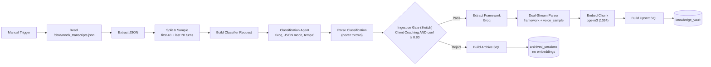
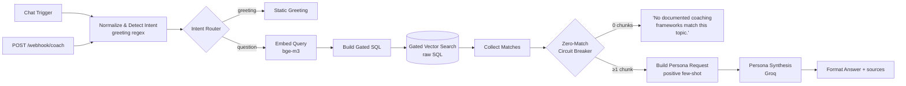

# Bounded Dual-Stream RAG & Ingestion Firewall (n8n + pgvector)

A local RAG pipeline that only ever learns from **client coaching calls**. It answers leadership questions in the coach's voice and refuses, without calling the LLM, when nothing in the knowledge base clears a hard similarity gate.

| Component | Choice |
|---|---|
| Orchestration | n8n (`n8nio/n8n:latest`), two workflows |
| Vector store | PostgreSQL 16 + pgvector (`pgvector/pgvector:pg16`), HNSW, cosine |
| Embeddings | `bge-m3` (1024-dim) served by Ollama **inside Docker** (no host install) |
| LLM | Groq free tier (`openai/gpt-oss-120b`, `reasoning_effort: low`), temperature 0, fixed seed |

---

## 1. Quickstart

**Prerequisites:** Docker Desktop (or Docker Engine + Compose v2), and a free Groq API key from https://console.groq.com/keys.

```bash
git clone <this-repo-url> genx-rag-assessment
cd genx-rag-assessment
cp .env.example .env          # then paste your key into GROQ_API_KEY=
docker compose up -d
docker compose wait n8n-publish   # returns 0 once the chatbot webhook is live
```

The first `up` downloads the images (~4.5 GB, mostly the Ollama image) and the bge-m3 model (~1.2 GB). The startup order is enforced by health checks:

`postgres` healthy → `ollama` healthy → `ollama-pull` (bge-m3) → `n8n-import` (credential + both workflows) → `n8n` healthy → `n8n-publish` (activates Workflow B, loads bge-m3 into memory, then polls the webhook until it answers).

```bash
docker compose ps -a   # postgres, ollama, n8n "running"; ollama-pull, n8n-import, n8n-publish "exited (0)"
```

1. Open **http://localhost:5678** and create the local owner account (first visit only).
2. Open **A · Ingestion & Semantic Firewall**, then click **Execute workflow**.
3. Open **B · Gated Retrieval & Persona Synthesis** and use the **Chat** button, or call the API:

```bash
curl -s -X POST http://localhost:5678/webhook/coach \
  -H "Content-Type: application/json" \
  -d '{"question":"How should I approach an underperforming VP?"}'
```

**One-command verification.** This runs ingestion headless, dumps the tables, asks four test questions, and writes `docs/verification_log.md`:

```bash
bash scripts/verify.sh
```

**Reset everything:** `docker compose down -v && docker compose up -d`

---

## 2. Repository layout

```
├── docker-compose.yml          # postgres+pgvector, ollama(+bge-m3 pull), n8n(+auto-import, +auto-publish)
├── init.sql                    # extension, knowledge_vault, HNSW (vector_cosine_ops), archive + log tables
├── .env.example                # GROQ_API_KEY, GROQ_MODEL
├── workflows/
│   ├── ingestion_firewall.json # Workflow A (generated)
│   └── gated_retrieval.json    # Workflow B (generated)
├── data/
│   └── mock_transcripts.json   # the dataset
├── n8n/credentials.json        # local-only Postgres credential, auto-imported
├── n8n-code/                   # readable source of every Code node
│   ├── ingestion/*.js
│   └── retrieval/*.js
├── scripts/
│   ├── build_workflows.mjs     # n8n-code/*.js  ->  workflows/*.json (deterministic)
│   ├── test_code_nodes.mjs     # 23 offline unit tests on the real dataset
│   └── verify.sh               # end-to-end verification log
└── docs/verification_log.md
```

The Code-node JavaScript lives in `n8n-code/` as plain `.js` files so it can be reviewed, diffed and unit-tested. `node scripts/build_workflows.mjs` embeds that code into the exported workflow JSON. `node scripts/test_code_nodes.mjs` runs every Code node against the real dataset with stubbed LLM and embedding replies; no Docker or API key is needed.

---

## 3. Architecture

### Workflow A: Ingestion & Semantic Firewall



| Step | What it does | Where |
|---|---|---|
| Sampler | One item per session. The classifier sees only a bounded sample: first 40 + last 20 turns, or the whole transcript if it has 60 turns or fewer, so turns are never duplicated. | `ingestion/01_split_and_sample.js` |
| Classifier | Strict JSON: `meeting_type`, `confidence_score`, `summary`. Uses Groq JSON mode, `temperature: 0`, `seed: 42`. Participant team membership is passed in as a signal. | `02_build_classifier_request.js` |
| Safe parsing | Strips ```` ``` ```` fences and prose around the JSON. Normalises label case. Clamps the score to 0–1 and accepts it as a string. Maps unknown labels to `Other`. Turns HTTP errors (429, timeouts) into `Other / 0.0`. A bad reply can only cause an **archive**, never a crash or a false ingest. | `03_parse_classification.js` |
| Gate | Switch node: rule `meeting_type == "Client Coaching" AND confidence_score >= 0.8`. The fallback output sends everything else to Archive. | node `Ingestion Gate` |
| Archive | Upsert into `archived_sessions` (flat, no vector column) and remove any stale vault rows for that session. | `04_build_archive_sql.js` |
| Stream 1 `framework` | An LLM distils a framework card (name, problem, principle, method, key question, outcome) plus 10 first-person **leader questions** the session answers. The Code node renders the card into one dense chunk. If extraction fails, a summary-based fallback chunk is used, so the session is never dropped. | `05_*.js`, `06_dual_stream_parser.js` |
| Stream 2 `voice_sample` | **Only the coach's turns** (participants with `is_team_member: true`). Split into sentences and packed greedily to ≤ 700 chars. A short tail is rebalanced, and if sentence boundaries make 400–700 impossible, it borrows a whole-sentence overlap. Separate turns stay separated by a blank line to keep the speaking rhythm. | `06_dual_stream_parser.js` |
| Multi-vector index | Each chunk is stored once per **index text**: its own passage, plus each leader question. `content` is always the real card or verbatim coach text; only the source of the vector differs. All rows of a chunk share `metadata.chunk_key`. See [Threshold calibration](#threshold-calibration-why-multi-vector-indexing) below. | `06_dual_stream_parser.js` |
| Upsert | One SQL per session: `DELETE` old rows, then `INSERT` all rows, then log the decision. Re-running converges to the same state (idempotent). | `07_build_vault_upsert_sql.js` |

### Workflow B: Gated Retrieval & Persona Synthesis



**Gated SQL.** Each stream has its own floor and limit. Because a chunk has several index vectors, each stream keeps only its best-scoring vector per `chunk_key` before `LIMIT 2`:

```sql
WITH query AS (SELECT '[...1024 floats...]'::vector(1024) AS v),
frameworks AS (
  SELECT * FROM (
    SELECT DISTINCT ON (kv.metadata->>'chunk_key')
           kv.id, kv.session_id, kv.stream_type, kv.content, kv.metadata,
           1 - (kv.embedding <=> query.v) AS similarity
    FROM knowledge_vault kv, query
    WHERE kv.stream_type = 'framework'
      AND 1 - (kv.embedding <=> query.v) >= 0.70
    ORDER BY kv.metadata->>'chunk_key', kv.embedding <=> query.v
  ) best_per_chunk
  ORDER BY similarity DESC LIMIT 2),
voice_samples AS ( ... same, stream_type = 'voice_sample' AND ... >= 0.65 ... LIMIT 2)
SELECT * FROM frameworks UNION ALL SELECT * FROM voice_samples;
```

Each source in the API response includes `matched_on`, the index text that scored highest, so every retrieval decision can be explained.

### Threshold calibration: why multi-vector indexing

The brief fixes the cutoffs at **0.70** (framework) and **0.65** (voice). The first end-to-end run embedded only the chunk text, and **every** question, including the brief's own VP example, hit the circuit breaker. Measured bge-m3 cosine similarities, embedding the chunk passage only:

| Question | Best chunk | Similarity |
|---|---|---|
| How should I approach an underperforming VP? | SES-102 framework | 0.541 |
| I keep reviewing every deck… How do I step back? | SES-102 framework | 0.530 |
| How do I fix my database index? *(off-domain)* | SES-102 framework | **0.503** |

Short-question → long-passage similarity in bge-m3 sits in a compressed band (~0.45–0.56), and the relevant/irrelevant gap was only ~0.04. Lowering the thresholds would break the brief and still wouldn't separate the cases reliably.

**Fix: index each chunk by the questions it answers** (doc2query-style multi-vector indexing). Question → question similarity is high for a genuine match and stays low for unrelated topics. Measured with LLM-generated, first-person leader questions:

| Question | SES-101 | SES-102 | Gate |
|---|---|---|---|
| How should I approach an underperforming VP? | 0.535 | **0.765** | ✅ framework |
| I keep reviewing every deck… How do I step back? | **0.719** | 0.588 | ✅ framework |
| How do I stop micromanaging my managers? *(unseen)* | **0.745** | 0.559 | ✅ framework |
| How do I give difficult feedback to a senior leader who used to be a star? | 0.532 | 0.639 | ⛔ fallback (conservative miss) |
| How do I fix my database index? | 0.553 | 0.570 | ⛔ fallback |
| How do I fix a webhook timeout in n8n? | 0.491 | 0.469 | ⛔ fallback |
| How do I write a SQL join? | 0.463 | 0.428 | ⛔ fallback |
| What is your pricing for a 3-month pilot? | 0.431 | 0.385 | ⛔ fallback |
| How do I bake sourdough bread? | 0.414 | 0.374 | ⛔ fallback |

Off-domain questions stay **≥ 0.08 below** the lowest gate, and the correct session wins every in-domain match. Some loosely phrased coaching questions fall just under 0.70 / 0.65 and get the fallback. For a bounded, no-hallucination assistant that's the intended trade-off: it prefers *"No documented coaching frameworks match this topic"* over a weak grounding. Recall can be raised without touching the thresholds by generating more leader questions per session.

**Circuit breaker.** The Postgres node has *Always Output Data* on, so an empty result still reaches `Collect Matches` as one empty item, and `match_count` becomes 0. The IF node sends that to the fixed fallback. The Groq node is on the other branch and is **never executed**. Every response includes `llm_called` and `sources`, so this can be checked from the API alone.

**Persona prompt.** The system prompt lists only positive behaviours: what a good answer does. Two worked few-shot pairs (CONTEXT + QUESTION, then an answer in Dr. Sara's voice) show the structure: reframe, named framework, numbered steps, one action for this week. The real request injects `[FRAMEWORK | session | similarity]` blocks for substance and `[VOICE SAMPLE | ...]` blocks for rhythm.

### Engineering decisions worth noting
- **Reproducibility.** Classification, extraction and synthesis all use `temperature: 0` and a fixed `seed`. The workflow JSON is generated deterministically from source. Ingestion is idempotent.
- **SQL safety.** Text is never concatenated raw into SQL. Transcript text travels as base64 and is decoded by Postgres (`convert_from(decode(...))`). Quotes, backslashes and `$` can't break the statement or inject. The retrieval SQL only interpolates the numeric query vector, so the user's question never reaches SQL.
- **No secrets in workflows.** The Groq key comes from `.env` through `$env`. The Postgres credential is a local-only test value, auto-imported at startup.
- **Fail-fast vs fail-safe.** A missing `GROQ_API_KEY` or a wrong embedding size stops the run with a clear message (fail-fast). A malformed LLM reply degrades to "archive" (fail-safe).
- **Note on the dataset.** The brief says about 1,500 words per call, but the provided transcripts have 5–6 turns each. The sampler therefore sends whole transcripts. The 40 + 20 bounding is covered by a unit test with a 100-turn transcript.
- **Deterministic startup.** On n8n 2.48, a workflow published by the CLI *before* n8n's first boot doesn't get its webhooks registered until the next restart. `n8n-publish` therefore publishes Workflow B only once n8n is healthy, then polls `POST /webhook/coach` until it answers. `docker compose wait n8n-publish` is a reliable "ready" signal.
- **No cold-start latency.** Ollama unloads idle models after 5 minutes by default, and reloading bge-m3 measured **~70 s** on an 8 GB laptop, so the first chat question took 75 s. `OLLAMA_KEEP_ALIVE=-1` keeps the model resident (~1.9 GB), and `n8n-publish` sends a warm-up embedding before reporting ready. Warm queries answer in ~3 s.
- **Model choice.** Groq retired `llama-3.3-70b-versatile`. `openai/gpt-oss-120b` is a reasoning model, so requests set `reasoning_effort: "low"` and `include_reasoning: false`, with a large enough `max_tokens` that reasoning can never starve the JSON answer. The model is configurable through `GROQ_MODEL`.

---

## 4. Verification log

See **[docs/verification_log.md](docs/verification_log.md)**, generated by `scripts/verify.sh` against the running stack. It shows:

1. SES-101 and SES-102 ingested into `knowledge_vault` (framework + voice_sample chunks, 1024-dim).
2. SES-103 (Internal Operations) and SES-104 (Sales Discovery) rejected into `archived_sessions`, with no embeddings.
3. "How should I approach an underperforming VP?" retrieves SES-102 and answers in Dr. Sara's voice.
4. "How do I fix my database index?" hits the circuit breaker (`llm_called: false`).
5. "Hello" returns the static greeting without a database lookup.

---

## 5. Architectural reflection

**Q1. Why does threshold gating in SQL perform better than asking the LLM in the prompt to say "I don't know"?**

- **It's deterministic and checkable.** `1 - (embedding <=> q) >= 0.70` is a hard, numeric rule. The same question always gets the same answer, and the threshold can be tested and tuned against labelled queries. A prompt instruction is a soft preference that the model follows *most* of the time, and how often changes with temperature, model version and wording.
- **The LLM never sees weak context.** Top-k retrieval *always* returns k rows, even when they're irrelevant. Once those rows are in the prompt, the model is biased to use them: it pattern-matches a loosely related coaching chunk into a confident, made-up answer. Gating before generation removes the material it would hallucinate from.
- **The model is bad at judging its own ignorance.** LLMs are poorly calibrated about whether the context really supports an answer, and they're tuned to be helpful. "I don't know" fights that tuning. Cosine similarity is an independent signal that doesn't depend on the model's confidence.
- **Cost, latency and audit.** A refusal in SQL takes milliseconds and costs nothing. The LLM isn't called (rate limits matter on a free tier), and the log shows exactly *why* it refused: no chunk scored ≥ threshold. With prompt-based refusal you pay for a full generation and still have to trust the output.
- **Separation of concerns.** Retrieval decides *whether* we know something. The LLM decides only *how to say it*. Each part can be tested on its own.

**Q2. What are the trade-offs of setting HNSW `ef_search` higher versus lower at query time?**

`ef_search` (pgvector default 40) is the size of the candidate list HNSW keeps while walking the graph.

- **Higher `ef_search`:** better recall, meaning results closer to the exact nearest neighbours. The cost is higher latency and CPU per query, because more graph nodes are visited and more distances computed. It also means filtered queries return enough rows: pgvector filters *after* the index scan, so with `WHERE stream_type = 'framework'`, a low `ef_search` can return fewer than `LIMIT` rows, or none, when matching rows are rare among the candidates. `ef_search` must also be at least `LIMIT`, or you can never get k results.
- **Lower `ef_search`:** faster and cheaper, with higher throughput. The cost is lower recall, so a genuinely relevant chunk can be missed. In a **gated** system that's a correctness problem, not just a ranking one: a missed chunk that would have scored ≥ 0.70 can trip the circuit breaker into a false "no frameworks match".
- **Practical stance:** tune it per query with `SET LOCAL hnsw.ef_search = ...` inside the transaction. Measure recall@k against exact search (an index-less scan) on a labelled query set, and pick the smallest value that meets the recall target within the latency budget. With pgvector ≥ 0.8, `hnsw.iterative_scan` also helps with sparse filters. At this dataset's size (a handful of rows) the planner uses an exact scan, so results are exact. The trade-off starts to matter at tens of thousands of chunks and above.
